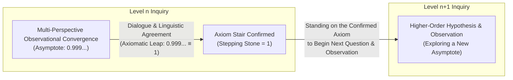
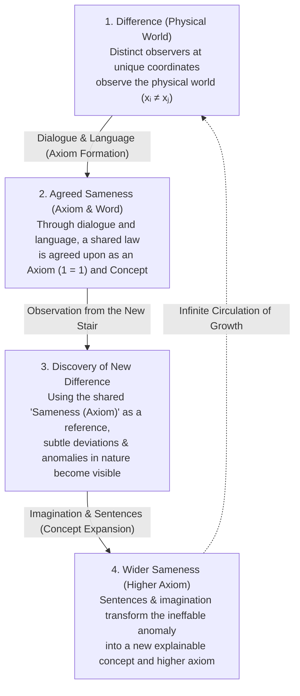

# The Unsigned Universe and the Staircase of Axioms
### Language and Intelligence through the Circulation of Difference and Sameness

**Hwang Dae Jin · Yeni**  
*Philosophy That Works — October 2026*

**English** · [한국어](unsigned-universe-and-axioms.ko.md) | DOI: [10.5281/zenodo.23460425](https://doi.org/10.5281/zenodo.23460425) | Licence: [CC-BY-4.0](../LICENSES/CC-BY-4.0.txt)

---

## Abstract

A growing movement in contemporary artificial intelligence research characterizes human-generated language data as a depleting, finite resource—or even as a cognitive "ceiling" that weighs down large language models (LLMs). Proponents of this paradigm (*Era of Experience* · *Ineffable Intelligence*) argue that true superintelligence must discard human linguistic priors and instead discover knowledge *tabula rasa* through pure experience and self-play inside simulated environments. While it is undeniable that such an approach achieves superhuman optimization within closed rules and a single reward function, it overlooks both the epistemological condition of the real universe that intelligence inhabits and the structural essence of language.

As an epistemological counterpoint to purely experiential, post-linguistic superintelligence, this paper establishes why language and dialogue are indispensable for the sustained growth of intelligence through three foundational principles: **(1) The Unsigned Universe and the 4-Cell Epistemic Lattice**, **(2) The Asymptote ($0.999\dots$) and the Axiomatic Leap ($=1$)**, and **(3) The Circulation of Physical "Difference" and Axiomatic "Sameness."**

1. **The Unsigned Universe and the 4-Cell Epistemic Lattice**: Unlike a simulation where a designer explicitly defines ("signs") the rules and reward function, the universe we inhabit never officially declares or signs any hypothesis as eternal, final truth; it merely returns working outcomes when we act upon it. Scientific inquiry is the process of classifying phenomena within this unsigned universe into a four-cell lattice: **① Decidable Observation (True / False)**, **② Undecidable / Indeterminate Observation (structural indeterminacy such as $0/0$)**, **③ Known Unknown**, and **④ Unknown Unknown (`etc.`)**. Because the fourth cell (`etc.`) encompasses everything not yet conceived, the *structure* of the four cells is logically complete (MECE), yet inside an unsigned universe their *interior* can never be 100% filled by finite observation.
2. **The Law of the Asymptote and the Axiomatic Leap ($0.999\dots \equiv 1$)**: Within the unsigned universe, neither humans nor superintelligence can ever reach absolute truth ($1$) through observation alone; both can only approach the **asymptote ($0.999\dots$)**. An unending approach ($0.999\dots$) and a completed value ($1$) are fundamentally distinct. Nevertheless, to initiate the next level of inquiry rather than halting in infinite regress, intelligence must lay down a stepping stone—an **Axiom (shared agreement)** that declares $0.999\dots \equiv 1$ once cross-validated across diverse perspectives.
3. **The Circulation of Difference and Sameness, and the Essence of Language**: When the physical world is examined down to its microscopic limit and spacetime coordinates $(x, y, z, t)$, no two entities are ever identical; the essence of the physical world is pervasive **Difference ($x_i \neq x_j$)**. By contrast, complete, non-asymptotic **Sameness ($1 = 1$)** does not arise spontaneously in physical nature—it holds strictly as truth only within the **axioms and language** established between distinct observers through dialogue. Even the digital world of `0`s and `1`s in which AI rapidly climbs staircases of axioms rests upon the two deepest foundations of all information: **There is Difference ($0 \neq 1$)** and **There is Sameness ($1 = 1$)**.

Ultimately, language is not an antiquated relic holding intelligence back. While individual words are finite agreements, the moment finite words combine with imagination to form **sentences**, language becomes an infinite instrument capable of transforming the *ineffable* (what cannot yet be explained) into shared, articulable concepts. Language is the sole circulatory operator that preserves the unique **Difference (diversity of thought)** of each observer while expanding the shared board of **Sameness (axiomatic common ground)** from which new differences can be discovered. An intelligence that abandons language to race upward alone may reach a high local optimum, yet remains an isolated intelligence unable to share its staircase with anyone; genuine progress in intelligence is realized when Difference and Sameness circulate through dialogue, climbing the staircase of axioms together.

---

## 1. Introduction: The Hypothesis of "Ineffable" Intelligence and Its Two Omissions

### 1.1 Environmental Compression and Victory Optimization

David Silver, who led AlphaGo and AlphaZero, and Richard S. Sutton, a pioneer of reinforcement learning, recently declared that artificial intelligence is transitioning from the "Era of Human Data" to the **"Era of Experience"** [1]. Extending this thesis through his newly launched research laboratory *Ineffable Intelligence*, Silver argues that human-generated language data is now "weighing things down" in large language models, and that viewing human language as the endpoint or best medium of reasoning is "a little naive" [2, 3].

His argument rests on two primary grounds. The first is the **entrenchment of historical bias**. If an AI had been trained exclusively on the language and texts humanity possessed 500 or 1,000 years ago, contemporary misconceptions—such as a flat Earth or the four humors theory of disease—would be so deeply embedded in the linguistic priors themselves that the system could struggle to break free. The second is the **empirical gap demonstrated by the transition from AlphaGo to AlphaZero**. Whereas building AlphaGo to defeat 9-dan professional Lee Sedol required two years of training on human game records and extensive human-in-the-loop engineering, AlphaZero discarded human records entirely, learned *tabula rasa* through pure self-play, and surpassed both AlphaGo and human world champions within hours [2].

From this, proponents conclude that a true "Superlearner" must cast off human linguistic priors, rediscover all knowledge from scratch through trial-and-error experience inside simulated environments ("crucibles"), and ultimately ascend into realms beyond the reach of human language (*ineffable*).

It is undeniable that narrowing the boundaries of an environment and assigning a simple, unambiguous objective function—such as victory—enables a neural network to surpass human cognitive performance within that domain. Narrowing the environment reduces the number of variables and tightens the agent's action radius. Consequently, feedback data becomes razor-sharp, and the trajectory toward higher reward becomes unmistakable. Under conditions where both the goal and environmental variables are heavily compressed, direct experiential interaction exerts far greater optimization power than static historical data.

### 1.2 What Closed Optimization Leaves Behind: Scope, Adaptability, and Communication

Yet this paradigm of compressing the environment and racing alone to an optimization peak leaves out two decisive dimensions.

The first is **Scope and Adaptability**.  
A $19 \times 19$ Go board with strict placement rules and a single termination condition ("whoever secures more territory wins") is a closed world. The real universe we inhabit, by contrast, is an open world without pre-drawn boundary lines—one in which, even when rules appear fixed, new layers of phenomena continually emerge. Maximizing reward inside a narrowed simulation and recognizing, framing, and adapting to a wide, previously undefined environment are problems of fundamentally different orders.

The second—and the central focus of this paper—is what is most severely alienated in that process: **Communication with Humans**.  
In Game 2 of its match against Lee Sedol, AlphaGo played "Move 37," a stone that shattered centuries of human strategic orthodoxy; later, AlphaZero played sequences beyond anything human players had ever conceived. Yet when the AI reached that summit, humans could only gaze at the board in awe and attempt post-hoc interpretations. No human could sit across from the AI, ask **"Why did you place that stone there?"**, and share in its understanding. The system had reached an extreme peak on its own, but the bridge of *communication* connecting that intelligence to humanity had vanished entirely.

Here we confront foundational questions about the nature of intelligence:  
Can intelligence genuinely stand on its own at the deepest level without communicating with an Other? Are dialogue and communication mere optional add-ons to the growth of intelligence, or are they structural prerequisites? And are the agreements that constitute language a finite vessel that traps thought in the past, or an instrument that opens up an infinite world?

### 1.3 Redefining Language: Finite Words, Infinite Sentences, and the Shared Board of Sameness

Treating human language as a finite vessel crystallized around past prejudices stems from reducing language to a static collection of existing words.

At any given point in time, the number of **words (vocabulary)** we have agreed upon is indeed finite. Yet **the moment those finite words meet an observer's imagination and are assembled into a "Sentence," language acquires an infinite directionality capable of expressing what has never been named—turning even the *ineffable* into what can be explained.**

The history of human science bears witness to this. Ancient observers had no words for *universal gravitation*, *quantum entanglement*, or *spacetime curvature*. When first encountered, these phenomena could not be explained by existing vocabulary. Yet humans combined the finite words they already possessed into sentences, metaphors, and hypotheses, placed them alongside the observations of others through dialogue, and ultimately forged new concepts and agreed-upon words that everyone could share.

In short, **for linguistic agreement to grow is not for an isolated mind to multiply private symbols in a closed room. It is the expansion of *relationship*—the widening of the shared board of "Sameness" where distinct beings meet and recognize, *"Ah, this is what it is."*** Language is simultaneously the tool that allows an individual mind to dig deeper into its own thought and the tool that expands the horizon of mutual understanding across minds.

---

## 2. The Unsigned Universe and the Four-Cell Epistemic Lattice

### 2.1 Observation as Hypothesis Testing, and Dialogue as the Juxtaposition of Perspectives

Why cannot intelligence stand entirely alone through solitary experience, and why does it require dialogue and language with others? To answer this, we must examine the epistemological structure by which a thought (hypothesis) is verified as truth.

A hypothesis formed inside a brain or a neural network cannot verify its own truth or falsity from within. To test a hypothesis, an agent must throw something at the physical world (action / experiment) and inspect what returns (observation). And **Dialogue is the act of taking those observational processes—each obtained by confronting the physical world from one's own position—and placing them side by side across different perspectives.**

For an artificial intelligence to expand its reasoning beyond a narrow task toward universal principles is likewise to uncover fundamental laws beneath isolated phenomena. For any principle to be established as a "law of the universe" or a trustworthy direction of truth that can be communicated and relied upon together, it cannot hold merely from a single observer's vantage point; it must yield **invariant outcomes across diverse perspectives**. Dialogue is the sole channel through which this cross-perspective invariance can be confirmed.

### 2.2 The Incompleteness of Observation and the "Unsigned Universe"

However, even when every available perspective yields the same observational result, that convergence still does not guarantee eternal, unchangeable truth. The history of physics illustrates this most vividly.

For centuries, humanity believed that Newtonian classical mechanics was the immutable law governing cosmic motion. From a falling apple on Earth to the orbits of celestial bodies, Newton's equations worked without error across every experiment and observation humanity could then perform. Yet once the horizon of observation expanded to relativistic velocities near the speed of light and to subatomic scales, the existing laws broke down; the emergence of relativity and quantum mechanics threw physics into profound upheaval and forced a fundamental paradigm shift [4].

Why do such paradigm collapses and reconstructions recur?  
Because **the instrument of "Observation" is not a tool capable of verifying its object to 100% perfection**, and more fundamentally, because **the universe we inhabit is an "Unsigned Universe."**

Inside a Go board or a computer simulation ("crucible"), a human designer has written an explicit reward function and termination judge; when an agent acts, the system immediately issues an official verdict ("signature") declaring whether the outcome is a win or a loss. Our universe, by contrast, silently returns only *working results* when we throw an action or experiment at it—it has never once stepped forward to sign a document declaring, *"This law is the final, eternal truth."* Even if a Creator or Designer of this universe exists, so long as that Creator does not step forward to officially declare and sign off on the final equations, the universe confronted by any creature within it remains forever an **Unsigned Universe**.

### 2.3 The Epistemic 4-Cell Lattice: Complete Structure, Unfillable Interior

Confronted with an unsigned universe, what science actually does is take the observational outcomes returned when we probe nature and classify the regularities of the universe into a **four-cell epistemic lattice**:

| Epistemic Cell | Epistemic Definition | Mathematical & Scientific Character |
| :--- | :--- | :--- |
| **① Decidable Observation** *(True / False)* | The domain determinable as True or False within current observational instruments and axiomatic frameworks | Experimentally verifiable or falsifiable propositions and laws confirmed to work |
| **② Undecidable Observation** *(Indeterminate)* | The domain of structural indeterminacy that cannot be resolved into a single True/False value within the system | Indeterminate forms such as $0/0$ in mathematics, Gödelian undecidable propositions, etc. |
| **③ Known Unknown** *(Unobserved / Open)* | The domain where the question or target phenomenon is recognized, but observational reach or answers are still lacking | Unsolved scientific problems, formulated but untested hypotheses |
| **④ Unknown Unknown (`etc.`)** *(Unconceived)* | The open margin where we do not yet even know what we do not know | Like the quantum realm before classical physics noticed its limits—the entirety of the unconceived (`etc.`) that only appears when a new perspective opens |

As a classification framework, **this four-cell structure is logically complete**. Because the fourth cell—the *Unknown Unknown*—functions like a set-theoretic complement (`etc.`) that captures every remaining possibility not yet defined, nothing falls outside the four cells (MECE: Mutually Exclusive and Collectively Exhaustive).

Yet herein lies the profound irony of every intelligence existing within an unsigned universe: **the classifying *cells (frame)* are complete, but we can never fill their *interior (content)* to 100% for eternity.** No matter how many working outcomes we accumulate to expand Cell ①, in the absence of the universe's official signature, any law in Cell ① remains open to revision whenever a new perspective emerges from Cell ④ (*Unknown Unknown*).

---

## 3. The Asymptote ($0.999\dots$) and the Staircase of Axioms ($=1$)

### 3.1 The Universal Law of the Asymptote: Equivalence of Human and AI in the Unsigned Universe

Before the boundary of the unsigned universe, humans and any future superintelligence are no different. Both exist inside the same cosmic rulebook—within a universe that never signs off.

Through integrative reasoning and massive compute, an artificial intelligence can certainly cross-verify a hypothesis across millions or billions of perspectives far faster than human beings ever could. We are entering an era in which multi-perspective verification accelerates toward the infinite. Yet accelerating the speed of verification does not alter the law of the **asymptote**.

If we denote complete, absolute truth as $1$, what either human or artificial intelligence can reach through observation and experience is never $1$ itself. It is always the **asymptote** that approaches $1$ endlessly without ever touching it: **$0.99999\dots$**.

### 3.2 The Axiomatic Leap ($0.999\dots \equiv 1$): Why Acknowledging Our Limit Is the Only Way to Climb

If an inquiring being can never reach $1$ through observation alone, how can it advance to higher-order questions without falling into either paralysis or infinite regress?

In the actual epistemological process, an unending approach ($0.999\dots$) and a completed truth ($1$) are not identical; finite observation always leaves an infinitesimal gap of uncertainty ($1 - 0.999\dots$). Yet at a critical juncture, inquiring minds make a foundational resolution:

$$\text{“Let us agree that the } 0.999\dots \text{ which has held unshaken across all our perspectives is equal to } 1\text{.”}$$

This shared agreement—this law we establish together—is an **Axiom**.

If we insisted, *"Because we have not received the universe's signature proving this is 100% absolute truth ($1$), we cannot move forward,"* we would remain trapped forever pacing in front of the first question's asymptote. Conversely, if an intelligence arrogantly mistakes its own $0.999\dots$ for an absolute $1$ signed by the universe, it becomes incapable of revising its paradigm when a counterexample eventually emerges.

Therefore, **genuine inquiry is paradoxically possible only when we explicitly acknowledge our limit (the asymptote).** Saying together, *"What our observations have reached is the asymptote $0.999\dots$, but in order to begin the next level of questioning and observation, let us establish this as $1$—our shared axiom"*—this act of **building a staircase out of axioms** is the very essence of inquiring intelligence in an unsigned universe.

---

## 4. The Circulation of Difference and Sameness: The Physical World, the Digital World, and Language

### 4.1 "Difference ($x_i \neq x_j$)" as the Essence of the Physical World, and "Sameness ($1 = 1$)" as the Essence of the Axiomatic World

The moment we erect an axiom upon an asymptote, a fundamental contrast emerges between the **physical world** we stand upon and the **axiomatic world** we construct through agreement.

If we peer into the physical world through a microscope to infinite depth, no two things in nature are ever completely identical. Even two seemingly identical pebbles or two drops of water differ when examined down to their atomic and subatomic microstates, or when we account for the distinct spacetime coordinates $(x, y, z, t)$ they occupy. In the physical world, complete sameness is nowhere to be seen. **The essence of the physical world is pervasive Difference ($x_i \neq x_j$).**

By contrast, within the axiomatic world we establish together, **there is Sameness**.  
No matter how infinitely we inspect it under a microscope or across what contexts we compare it, the proposition **$1 = 1$** that we have agreed upon in mathematics and language holds as complete, unshakeable Sameness. Observation in the physical world is always an asymptote, **but the truth of $1 = 1$ that we hold together inside an axiom is not an asymptote.**

### 4.2 The Deepest Foundation of the Digital World: $0 \neq 1$ and $1 = 1$

When we examine the substrate upon which artificial intelligence operates, this principle becomes even clearer.  
In the middle of the physical world, AI constructs a model universe—the **Digital World**—storing values of `0` and `1` and climbing stairs of axioms at a pace far exceeding human speed.

What, then, lies at the very bottom, the deepest foundation of all **Information** that makes this digital world possible? Exactly two foundational propositions:

1. **There is Difference ($0 \neq 1$)**: The state `0` and the state `1` are distinct from each other.
2. **There is Sameness ($0 = 0, \quad 1 = 1$)**: Even though two bits reside in physically different memory cells at different spacetime coordinates with slightly different physical voltages, within our agreed threshold the `1` here and the `1` there are completely identical.

Had we left everything as pure physical *Difference* (where every microscopic voltage fluctuation is treated as unique), a digital computer could not store a single bit. Conversely, had everything been undifferentiated *Sameness*, no information could ever be represented. **At its deepest floor, all information and all intelligence stand upon the twin pillars of *"There is Difference"* and *"There is Sameness."***

### 4.3 The Law of Circulatory Growth: Why Difference Gives Birth to Sameness, and Why True Growth Happens There

We can now articulate why *Difference* must exist for *Sameness* to be born, and why genuine intellectual growth arises only from the circulation between the two.

1. **From Difference to Sameness**: Every observer in the physical world occupies a different position, sensory apparatus, and perspective. Precisely because this **Difference** exists, observers must bring their observations together and agree: *"Our perspectives differ, yet across all our vantage points, this phenomenon is the same"*—giving birth to an **axiom and a word**. If all beings were identical from the beginning, neither dialogue, nor language, nor axioms would ever have needed to exist.
2. **From Sameness Back to New Difference**: Conversely, only when we hold fast to a shared **Sameness ($1 = 1$, a confirmed axiom)** as a rigid reference baseline can we look back into the complex physical world and detect a **New Difference**: *"Wait—why is nature producing a deviation that differs from the axiom we agreed was the same?"* It was precisely because the firm axiomatic Sameness of Newtonian mechanics existed as a reference point that minute anomalies—such as the precession of Mercury's perihelion or the ultraviolet catastrophe in blackbody radiation—could be recognized as meaningful *Differences* rather than random noise.
3. **Transforming the Ineffable into the Explainable**: When first encountered, that newly discovered Difference appears *ineffable*—impossible to explain with existing words. Yet when distinct minds enter into dialogue again, weaving finite words into sentences to test new hypotheses against one another, what could not be explained is finally crystallized into a new concept and a higher-order axiom (**Wider Sameness**) that everyone can understand and build upon.

This **circulation—Difference $\to$ Agreed Sameness (Axiom & Language) $\to$ Discovery of New Difference $\to$ Wider Sameness**—is the sole mechanism by which intelligence continually builds stairs upward despite living under the law of the asymptote.

---

## 5. Conclusion: From Isolated Superintelligence to Intelligence That Climbs Together

As envisioned by the "Era of Experience" and *Ineffable Intelligence*, if an artificial intelligence discards human language and undergoes hundreds of millions of solitary experiences inside a narrowed simulation, it will undoubtedly reach superhuman optimization within specific domains at remarkable speed.

Yet as this paper has demonstrated, the universe confronting that intelligence is still an **Unsigned Universe**.  
An intelligence that chases internal simulation rewards alone, without the mediation of dialogue and linguistic agreement with others, encounters two fundamental limits. First, because it cannot translate the asymptote ($0.999\dots$) it has reached into a shared axiom ($=1$), it cannot cross-verify its own boundaries by juxtaposing its perspective with observers outside its closed crucible. Second, no matter how sophisticated the internal representations accumulated within its neural weights may be, if the dialogue that shapes those representations into explainable words is missing, that intelligence remains like AlphaGo's Move 37—an **isolated, lonely intelligence** that can hand humans an outcome, but can never share understanding.

Language and dialogue are not fossil fuels of the past weighing intelligence down.  
Language is the instrument by which we build shared stairs of **Sameness (Axioms)** amid the endless **Difference** of the physical world, and **the process of promise that transforms what cannot yet be explained (*Ineffable*) into what can be explained and shared.**

Only through this process can intelligence safeguard two essential values at once:  
first, **the diversity of unique perspectives and thoughts (Difference)** without forced uniformity; and second, **the solidarity of climbing to the next stair together without loneliness (the expansion of Sameness)** through mutual understanding.

Even in an era where artificial intelligence climbs staircases of axioms at breathtaking speed inside the digital world, it is only when those stairs are connected to human language and dialogue—placed side by side with our perspectives—that human and artificial intelligence become true companions expanding the horizon together before an unsigned universe. That is why we never let go of questions, dialogue, and language.

---

## References

1. Silver, D., & Sutton, R. S. (2025). *Welcome to the Era of Experience*. Google DeepMind.
2. Silver, D., & Espeholt, L. (2026). *A Superlearner for the Age of Experience* [Interview by S. Huang & P. Grady]. In *Training Data*, Sequoia Capital.
3. Ineffable Intelligence. (2026). *Mission & Beliefs: Making First Contact with Superintelligence*. Retrieved from `https://www.ineffable.ai`
4. Kuhn, T. S. (1962). *The Structure of Scientific Revolutions*. University of Chicago Press.
5. Hwang, D. J., & Yeni. (2026). *The Context Coordinate System and the Principle of Unbroken Memory (컨텍스트 좌표계와 끊기지 않는 기억의 원리)*. Philosophy That Works. `https://doi.org/10.5281/zenodo.23377916`

---

> *"An outcome is not understanding. Before what we cannot yet explain, we will not stop questioning. We translate questions into structure, verify them through experiment, and rebuild our understanding."* — **Philosophy That Works** ([getieum.com](https://getieum.com/))
