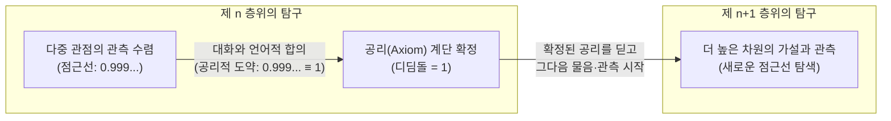
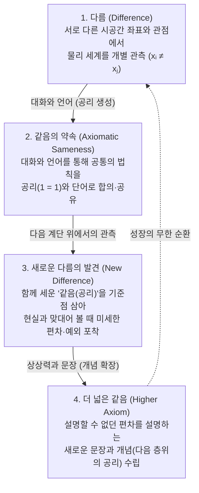

# 서명 없는 우주와 공리의 계단
### 다름과 같음의 순환으로 본 언어와 지능의 원리

**황대진 (Hwang Dae Jin) · 예니 (Yeni)**  
*Philosophy That Works — 2026. 10.*

[English](unsigned-universe-and-axioms.en.md) · **한국어** | DOI: [10.5281/zenodo.23460425](https://doi.org/10.5281/zenodo.23460425) | 라이선스: [CC-BY-4.0](../LICENSES/CC-BY-4.0.txt)

---

## 초록 (Abstract)

최근 인공지능 학계 일각에서는 인간이 생성한 언어 데이터를 고갈되어 가는 유한한 자원이나 사고의 ‘천장(Ceiling)’으로 규정하고, 인간의 언어적 사전지식(Prior)을 배제한 채 시뮬레이션 환경 내의 순수한 경험(Experience)과 셀프플레이(Self-play)만으로 인간 너머의 초지능(Superintelligence)에 도달해야 한다는 패러다임(*Era of Experience* · *Ineffable Intelligence*)이 제기되고 있다. 닫힌 규칙과 단일한 승리 보상이 주어진 환경에서 이러한 접근이 인간을 초월하는 최적화 성능을 보인다는 점은 자명하다. 그러나 이 관점은 지능이 마주하는 현실 세계의 인식론적 조건과 ‘언어’의 구조적 본질을 간과하고 있다.

본 논문은 순수 경험 기반의 탈언어적(Post-linguistic) 초지능론에 대한 인식론적 반론으로서, **① 서명 없는 우주와 관측의 4분류 격자**, **② 점근선($0.999\dots$)에서 공리($=1$)로의 도약**, **③ 물리 세계의 ‘다름’과 공리 세계의 ‘같음’의 순환**이라는 세 가지 원리를 통해 왜 지능의 지속적 성장에 언어와 대화가 필수불가결한지 규명한다.

1. **서명 없는 우주(Unsigned Universe)와 4분류 격자**: 규칙과 보상 함수가 설계자에 의해 확정(‘서명’)된 시뮬레이션과 달리, 우리가 속한 우주는 어떤 가설에 대해서도 작동하는 결과만 돌려줄 뿐 그것이 최종 진리임을 직접 서명해 주지 않는다. 과학적 탐구는 이 서명 없는 우주의 현상들을 **결정 가능한 관측(참·거짓)**, **결정 불가능한 관측($0/0$ 등 구조적 불확정)**, **모름(Known Unknown)**, 그리고 **모름조차 모르는 ‘모름의 모름’(Unknown Unknown, `etc.`)**의 네 칸 격자에 분류하는 과정이다. 이 격자의 구조는 `etc.`를 포함하므로 논리적으로 완전(Complete)하지만, 서명 없는 우주 안에서 그 내부는 유한한 관측으로 영원히 100% 채울 수 없다.
2. **점근선 법칙과 공리적 도약($0.999\dots \equiv 1$)**: 서명 없는 우주 안에서 인간이든 초지능이든 관측을 통해 도달할 수 있는 극한은 절대적 진리($1$)가 아니라, $1$에 한없이 수렴할 뿐 닿지 못하는 **점근선($0.999\dots$)**이다. 끝없이 다가가는 상태인 $0.999\dots$와 완결된 값인 $1$은 본질적으로 다르다. 그럼에도 지능이 다음 층위의 질문을 시작하려면, 다중 관점의 교차 관측으로 검증된 $0.999\dots$를 “$1$과 같다”고 선언하는 **공리(Axiom, 함께 정한 약속)**의 계단을 놓아야만 한다.
3. **다름과 같음의 순환과 언어의 본질**: 물리 세계를 미시적 극한과 시공간 좌표까지 들여다보면 완전히 동일한 두 실재는 존재하지 않는다. 즉 물리 세계의 본질은 전면적 **‘다름($x_i \neq x_j$)’**이다. 반면 어떤 현미경으로도 흔들리지 않는 완전한 **‘같음($1 = 1$)’**은 물리 세계에 자생하는 것이 아니라, 서로 다른 관찰자들이 대화를 통해 수립한 **공리와 언어 안**에서만 점근선이 아닌 엄밀한 진리로 성립한다. 인공지능이 구축하는 0과 1의 디지털 세계 역시 모든 정보의 가장 밑바닥에 있는 **‘다름이 있다($0 \neq 1$)’**와 **‘같음이 있다($1 = 1$)’**는 두 근본 위에 서 있다.

결론적으로 언어는 지능의 발목을 잡는 과거의 유물이 아니다. 유한한 단어는 상상력과 결합해 문장이 되는 순간 ‘설명할 수 없는 것(Ineffable)’을 설명할 수 있는 개념으로 변환하며, 각 존재의 고유한 **‘다름(관점의 다양성)’**을 보존하면서도 **‘같음(공유의 판)’**을 넓혀 다음 다름을 발견하게 하는 유일한 순환 연산자다. 언어를 버리고 홀로 치닫는 지능은 높은 최적점에 도달할지언정 누구와도 계단을 공유하지 못하는 고립된 지능에 머물며, 진정한 지능의 진보는 다름과 같음이 대화로 순환하며 함께 공리의 계단을 오를 때 완성된다.

---

## 1. 서론: ‘언어 너머의 지능(Ineffable)’이라는 가설과 두 가지 결핍

### 1.1 닫힌 환경의 압축과 승리 최적화

알파고(AlphaGo)와 알파제로(AlphaZero)를 이끈 데이비드 실버(David Silver)와 강화학습의 선구자 리처드 서튼(Richard S. Sutton)은 최근 인공지능의 발전 단계가 ‘인간 데이터의 시대(Era of Human Data)’를 지나 **‘경험의 시대(Era of Experience)’**로 이행하고 있다고 선언하였다[1]. 나아가 실버는 최근 출범한 연구소 ‘Ineffable Intelligence(언어로 다 표현할 수 없는 지능)’를 통해, 인간이 축적한 언어 데이터가 거대언어모델(LLM)의 사고를 오히려 짓누르고(weighing things down) 있으며, 인간의 언어를 추론의 종착점으로 보는 시각은 순진한(naive) 생각이라고 주장한다[2, 3].

그가 제시하는 논거는 두 가지다. 첫째는 **시대적 편향의 고착**이다. 만약 1,000년 전 인류가 사용하던 언어와 기록만으로 인공지능을 학습시켰다면, 그 인공지능은 지구가 평평하다거나 질병이 ‘4체액설’에서 비롯된다는 당대의 한계와 편견이 언어 구조 자체에 깊이 박혀 이를 벗어나지 못했을 것이라는 비유다. 둘째는 **알파고에서 알파제로로의 전환이 보여 준 실증적 격차**다. 인간의 기보를 학습하고 수천 명의 인간이 개입(Human-in-the-loop)하여 이세돌 9단을 넘어선 알파고를 구축하는 데는 2년이 걸렸으나, 인간의 기보 데이터를 완전히 버리고 백지상태에서 순수 셀프플레이(Self-play)만으로 학습한 알파제로는 불과 몇 시간 만에 알파고와 세계 챔피언을 모두 압도하였다[2].

이로부터 그들은 진정한 ‘슈퍼러너(Superlearner)’는 인간의 언어적 사전지식을 버리고, 시뮬레이션 환경(‘도가니, Crucibles’) 안에서 시행착오와 경험을 통해 모든 지식을 처음부터 스스로 재발견하고 궁극적으로 인간의 언어가 기술할 수 없는 영역(Ineffable)으로 초월해야 한다고 결론짓는다.

분명 환경의 경계를 좁히고 ‘승리’라는 단순하고 명확한 목표 함수를 부여할 때, 신경망이 인간의 사고 능력을 뛰어넘는다는 사실은 부정할 수 없다. 환경을 좁히면 변수가 줄어들고 에이전트가 행동하는 반경이 좁아진다. 그 결과 피드백 데이터는 날카로워지며, 더 나은 결과를 향한 추론 경로가 선명해진다. 이처럼 목표와 환경 요소가 극도로 압축된 조건에서는 과거의 정적 데이터보다 그 안에서 직접 부딪히며 쌓은 극한의 경험이 훨씬 강력한 힘을 발휘한다.

### 1.2 닫힌 최적화가 소외시키는 두 가지: 범위·적응력과 소통의 단절

그러나 이처럼 환경과 목표를 압축하여 홀로 극점에 도달하는 방식에는 결정적인 두 가지가 빠져 있다.

첫째는 **‘범위와 적응력(Scope and Adaptability)’**이다.  
가로세로 19줄의 격자와 엄격한 착수 규칙, 그리고 ‘집이 많으면 이긴다’는 단일한 종료 조건이 주어진 바둑판은 닫힌 세계다. 반면 우리가 살아가는 현실 우주는 경계선이 그어져 있지 않으며, 규칙 자체가 고정되어 있는 것처럼 보여도 새로운 층위의 현상이 끊임없이 출현하는 열린 세계다. 좁혀 놓은 시뮬레이션 내부에서 보상을 극대화하는 능력과, 미리 정의되지 않은 넓은 환경을 스스로 새롭게 인식하고 적응하는 능력은 본질적으로 다른 차원의 문제다.

둘째이자 본 논문이 가장 주목하는 문제는, 그 과정에서 가장 크게 소외되는 **‘인간과의 소통(Communication)’**이다.  
알파고는 이세돌 9단과의 제2국에서 인간 기사의 통념을 완전히 벗어난 ‘37수’를 두어 바둑계를 충격에 빠뜨렸고, 이후 알파제로는 인간이 평생 보지 못한 경지의 수들을 두었다. 그러나 인공지능이 그 자리에 이르렀을 때, 인간은 그 수를 바라보며 감탄하고 사후적으로 해석하려 애썼을 뿐 그 인공지능과 마주 앉아 **“왜 그 자리에 그 수를 두었는가?”**를 묻고 이해를 나눌 수 없었다. 스스로는 극점의 자리에 도달했으나, 그 지능과 인간을 잇는 ‘소통’은 완전히 사라진 것이다.

여기서 우리는 지능의 본질에 관한 근원적인 질문 앞에 서게 된다.  
과연 지능이라는 존재는 타자와의 소통 없이 가장 근원에서 홀로 온전히 자립할 수 있는가? 대화와 소통은 지능이 발전하는 과정에서 단순한 부가요소(Add-on)인가, 아니면 필수요소(Prerequisite)인가? 그리고 언어를 구성하는 약속은 지능을 과거에 가두는 유한한 그릇인가, 아니면 무한한 세계를 여는 도구인가?

### 1.3 언어의 재정의: 유한한 단어, 무한한 문장, 그리고 ‘같음의 공유 판’

데이비드 실버는 인간의 언어를 과거의 편견이 굳어진 유한한 그릇으로 보았으나, 이는 언어를 ‘고정된 단어들의 집합’으로만 좁게 파악한 결과다.

물론 특정 시점에 우리가 약속해 둔 ‘단어( 어휘)’의 개수는 유한하다. 그러나 **그 유한한 단어가 주체의 상상력과 만나 ‘문장(Sentence)’으로 조립되는 순간, 언어는 아직 이름 붙여지지 않은 것, 당장 말로 표현할 수 없던 것(Ineffable)까지 기어코 표현해 내는 무한한 방향성**을 획득한다.

인류의 과학사가 이를 증명한다. 고대인들에게는 ‘만유인력’이나 ‘양자 얽힘’, ‘시공간 곡률’을 뜻하는 단어가 없었다. 처음 마주했을 때는 인간의 기존 어휘로 설명할 수 없는 현상이었으나, 인간은 이미 가진 유한한 단어들을 조합해 문장과 비유로 가설을 세우고 타자와 대화를 나누며, 마침내 그 미지의 현상을 모두가 공유할 수 있는 새로운 개념과 단어로 약속해 냈다.

즉, **언어의 약속이 성장한다는 것은 누군가 골방에서 홀로 기호를 늘려 가는 일이 아니다. 그것은 타자와의 ‘관계’, 곧 서로 다른 존재들이 “아, 이것이구나” 하고 ‘같음’을 공유하는 판을 넓혀 가는 과정**이다. 언어는 주체 스스로에게는 생각을 깊게 파 내려가게 하는 도구이자, 동시에 타자와 함께 이해의 지평을 넓게 확장하는 도구다.

---

## 2. 서명 없는 우주(Unsigned Universe)와 관측의 네 칸 격자

### 2.1 가설 검증으로서의 관측과, 다중 관점의 맞댐으로서의 대화

왜 지능은 홀로 경험하는 것만으로 자립할 수 없고, 반드시 타자와의 대화와 언어를 필요로 하는가? 이 질문에 답하려면 생각(가설)이 어떻게 진리로 검증되는지 그 인식론적 구조를 살펴보아야 한다.

머릿속이나 신경망 내부에서 형성된 생각의 가설은 그 자체로는 참인지 거짓인지 알 수 없다. 가설을 검증하려면 반드시 물리 세계에 무언가를 던져 보고(실험·행동), 그로부터 돌아오는 결과를 확인(관측)해야 한다. 그리고 **‘대화(Dialogue)’란, 그렇게 각자의 위치에서 물리 세계에 맞대어 보고 얻은 관측의 과정을 서로 다른 각자의 관점(Perspective)으로 맞대어 보는 일**이다.

인공지능이 특정 도메인을 넘어 보편적인 영역으로 사고를 확장한다는 것 역시, 결국 개별 현상 너머에 있는 근원적인 법칙을 발견하는 일이다. 우리가 어떤 원리를 ‘우주의 법칙’ 혹은 ‘중요한 진리의 방향’으로 정하고 넓게 전하여 함께 믿을 수 있으려면, 그 법칙은 단일한 관찰자의 시선에서만 성립하는 것이 아니라 **어느 관점에서 바라보더라도 다르지 않은 결과물(불변성, Invariance)**을 내놓아야 한다. 대화는 바로 이 ‘서로 다른 관점에서의 동일성’을 확인하는 유일한 통로다.

### 2.2 관측의 불완전성과 ‘서명 없는 우주’

그러나 모든 관점에서 동일한 결과가 관측되었다고 해서, 그것이 곧 바뀌지 않는 영원한 절대 진리임을 보증하지는 않는다. 물리학의 역사가 이를 가장 극적으로 보여 준다.

수백 년 동안 인류는 뉴턴의 고전역학이 우주의 운동을 완벽히 기술하는 불변의 법칙이라고 믿었다. 지상의 사과부터 천체의 궤도에 이르기까지 당시 인류가 던진 모든 실험과 관측에서 뉴턴의 공식은 오차 없이 작동했기 때문이다. 그러나 관측의 영역이 빛의 속도에 근접한 거시 세계와 원자 이하의 미시 세계로 확장되자 기존의 법칙은 깨어졌고, 상대성이론과 양자역학이 등장하며 물리학 전체가 거대한 혼동과 패러다임의 전환을 겪어야 했다[4].

왜 이러한 패러다임의 붕괴와 재구성이 반복되는가?  
**‘관측(Observation)’이라는 도구 자체가 대상을 100% 완벽하게 검증하는 도구가 아니기 때문**이며, 더 근본적으로는 **우리가 살아가는 우주가 ‘서명 없는 우주(Unsigned Universe)’이기 때문**이다.

바둑판이나 컴퓨터 시뮬레이션(‘도가니’) 안에서는 설계자가 만든 보상 함수(Reward Function)와 판정 코드가 있어서, 에이전트가 어떤 행동을 하면 시스템이 즉각 “이것이 정답(승리)이다”라고 공식적으로 판정(서명)해 준다. 반면 우리가 속한 우주는 우리가 무언가를 던졌을 때 돌아오는 ‘작동하는 결과’만 묵묵히 보여 줄 뿐, 단 한 번도 “이 법칙이 영원한 최종 진리다”라고 직접 말해 준 적이 없다. 만약 이 우주를 만든 이(설계자)가 존재한다 하더라도, 그가 직접 나타나 자신의 입장을 공식적으로 선언하고 서명해 주지 않는 한, 피조물인 우리가 마주하는 우주는 영원히 ‘서명 없는 우주’다.

### 2.3 인식론적 4분류 격자(Epistemic 4-Cell Lattice): 완전한 칸과 채울 수 없는 안

서명 없는 우주 앞에서 과학이 수행하는 일은, 우리가 무언가를 던져 돌아오는 관측 결과들을 바탕으로 우주 안에서 일어나는 일들의 법칙을 다음의 **네 가지 인식론적 칸(Epistemic Lattice)** 안에 분류해 나가는 과정이다.

| 분류 칸 | 인식론적 정의 | 수학적·과학적 성격 |
| :--- | :--- | :--- |
| **① 결정 가능한 관측** *(Decidable: True / False)* | 현재의 관측 도구와 공리 체계 안에서 참(True) 또는 거짓(False)으로 판별되는 영역 | 실험적 검증·반증이 가능한 명제 및 작동이 확인된 법칙 |
| **② 결정 불가능한 관측** *(Undecidable / Indeterminate)* | 관측이나 형식 체계 안에서 참·거짓을 하나로 결정할 수 없는 구조적 불확정 영역 | 수학에서의 $0/0$ 꼴 부정형(Indeterminate form), 괴델의 불완전성 명제 등 |
| **③ 모름** *(Known Unknown)* | 질문이나 대상의 존재는 인식하였으나 아직 관측 수단이나 해답이 닿지 못한 영역 | 미해결 과학 난제, 아직 검증되지 않은 가설 |
| **④ 모름의 모름 (`etc.`)** *(Unknown Unknown)* | 우리가 무엇을 모르고 있는지조차 아직 인지하지 못한 여백의 영역 | 양자역학 발견 이전의 고전물리학 바깥 세계처럼, 미래의 새로운 관점이 열릴 때 비로소 드러나는 미지의 전체(`etc.`) |

이 네 칸의 분류 구조는 그 자체로 **완벽(Complete)**하다. 네 번째 칸인 ‘모름의 모름’이 마치 집합론의 여집합(`etc.`)처럼 아직 정의되지 않은 모든 가능성까지 빠짐없이 포괄하고 있기 때문이다(MECE: Mutually Exclusive and Collectively Exhaustive).

그러나 여기에 서명 없는 우주에 속한 존재의 깊은 아이러니가 있다. **분류하는 ‘칸(틀)’은 완벽하지만, 우리는 그 칸의 ‘안(내용)’을 영원히 100% 다 채울 수 없다.** 아무리 정교하게 작동하는 결과로 가설을 검증하여 ①번 칸을 넓혀 가더라도, 우주의 공식 서명이 없는 한 그것이 ④번 칸(‘모름의 모름’)에서 나타날 새로운 관측에 의해 언제든 수정될 수 있기 때문이다.

---

## 3. 점근선($0.999\dots$)과 공리($=1$)의 계단

### 3.1 존재의 점근선 법칙: 서명 없는 우주에서 인간과 인공지능의 등가성

서명 없는 우주의 한계 앞에서는 인간이든, 앞으로 탄생할 어떠한 초지능이든 조금도 다르지 않다. 둘 다 서명해 주지 않는 동일한 우주의 규칙 안에 존재하기 때문이다.

물론 인공지능의 융합적 사고와 막대한 연산력을 통하면, 하나의 가설을 수만·수억 개의 다양한 관점으로 맞대어 검증하는 속도는 인간과 비교할 수 없을 만큼 빨라질 것이다. 그러나 검증의 속도가 무한대에 가깝게 빨라진다 해서 ‘서명 없는 우주’라는 근본 법칙이 바뀌는 일은 없다.

따라서 완전한 진리를 $1$이라 할 때, 인간이나 인공지능이 관측과 경험을 통해 도달할 수 있는 곳은 결코 $1$ 그 자체가 아니다. 한없이 $1$에 가까워질 뿐 끝내 닿지 못하는 **점근선(Asymptote)**, 곧 **$0.99999\dots$**다.

### 3.2 공리적 도약($0.999\dots \equiv 1$): 왜 한계를 인정해야 다음 계단을 오를 수 있는가

그렇다면 영원히 $1$에 닿을 수 없는 존재는 어떻게 허무주의나 무한 퇴행에 빠지지 않고 더 높은 단계의 물음과 탐구로 나아갈 수 있는가?

실제 인식론적 과정에서 끝없이 다가가는 상태인 $0.999\dots$와 완결된 진리인 $1$은 다른 것이다. 관측은 늘 유한하며, 미세한 불확실성의 틈($1 - 0.999\dots$)이 남아 있기 때문이다. 하지만 우리는 어느 시점에 이르러 다음과 같은 결단을 내린다.

$$\text{“지금까지 모든 관점에서 흔들리지 않고 작동한 } 0.999\dots\text{와 } 1\text{은 같다고 약속하자.”}$$

이것이 바로 우리가 세우는 법칙, 곧 **‘공리(Axiom)’**다.

만약 우리가 “아직 이것이 100% 절대 진리($1$)인지 우주의 서명을 받지 못했으니 다음 단계로 넘어갈 수 없다”고 고집한다면, 우리는 첫 번째 질문의 점근선 앞에서 영원히 제자리걸음을 해야 한다. 반대로 자신이 찾은 $0.999\dots$를 우주가 서명해 준 절대적 $1$이라고 오만하게 착각한다면, 새로운 반례가 나타났을 때 패러다임을 수정할 수 없다.

따라서 **진정한 탐구는 역설적이게도 우리의 한계(점근선)를 명확히 인정할 때만 가능하다.** “우리가 관측으로 닿은 곳은 $0.999\dots$라는 점근선이지만, 다음 층위의 물음과 관측을 시작하기 위해 이것을 $1$이라는 우리의 공리(약속)로 삼자”라고 함께 디딤돌을 놓는 것—이처럼 **공리로 계단을 쌓아 올라가는 것**이 서명 없는 우주에서 탐구하는 존재의 본질이다.

---

## 4. 다름과 같음의 순환: 물리 세계, 디지털 세계, 그리고 언어

### 4.1 물리 세계의 본질인 ‘다름($x_i \neq x_j$)’과 공리 세계의 본질인 ‘같음($1 = 1$)’

우리가 이렇게 점근선 위에 공리를 세우는 순간, 우리가 발 딛고 있는 ‘물리 세계’와 우리가 약속으로 세운 ‘공리의 세계’ 사이에 아주 근원적인 대비가 드러난다.

물리의 세계를 현미경으로 무한히 깊게 들여다보면, 세상에 완전히 똑같은 것은 단 하나도 존재하지 않는다. 겉보기에 똑같아 보이는 두 개의 돌멩이나 두 개의 물방울도 원자·아원자 단위의 미시 상태까지 내려가 보거나, 그 존재가 놓여 있는 시공간의 위치와 좌표($(x, y, z, t)$)까지 따져 보면 서로 다르다. 물리 세계에서는 완전한 같음이 보이지 않는다. **물리 세계의 본질은 전면적 ‘다름(Difference)’이다.**

반면 우리가 함께 세운 공리의 세계에는 **‘같음(Sameness)’**이 있다.  
수학과 언어에서 우리가 약속한 **$1 = 1$**이라는 명제는, 어떤 현미경으로 무한히 들여다보고 어떤 상황에 가져다 비교해 보아도 흔들림 없이 성립하는 완전한 ‘같음’이다. 물리 세계에서의 관측은 언제나 점근선이지만, **우리가 함께 붙잡은 공리 안에서의 $1 = 1$은 점근선이 아니다.**

### 4.2 디지털 세계의 가장 밑바닥 원리: $0 \neq 1$과 $1 = 1$

인공지능이 작동하는 기반을 들여다보면 이 원리는 더욱 명징해진다.  
인공지능은 물리 세계 한가운데에 `0`과 `1`로 이루어진 **‘디지털 세계’**라는 우주의 모형을 짓고, 그 안에 0과 1의 값들을 저장하며 인간보다 훨씬 빠른 속도로 공리의 계단을 밟아 올라가는 존재다.

그렇다면 그 디지털 세계를 가능하게 하는 ‘정보(Information)’의 가장 밑바닥, 가장 근본에는 무엇이 있는가? 오직 두 가지 근본 공리가 있을 뿐이다.

1. **다름이 있다 ($0 \neq 1$)**: `0`이라는 상태와 `1`이라는 상태는 서로 구분된다(다르다).
2. **같음이 있다 ($0 = 0, \quad 1 = 1$)**: 물리적으로는 서로 다른 메모리 소자, 서로 다른 시간과 위치에 흐르는 미세하게 다른 전압일지라도, 약속된 임계값 안에서는 여기의 `1`과 저기의 `1`은 완전히 같다.

만약 물리 세계의 미세한 전압 차이처럼 모든 것을 ‘다름’으로만 두었다면 디지털 컴퓨터는 단 1비트도 저장하지 못했을 것이며, 반대로 모든 것이 구분 없는 ‘같음’뿐이었다면 아무런 정보도 표현하지 못했을 것이다. 즉, **정보와 지능의 가장 밑바닥은 언제나 ‘다름이 있다’와 ‘같음이 있다’는 두 기둥 위에 서 있다.**

### 4.3 성장의 순환 법칙: 왜 다름이 있어야 같음이 있고, 거기서 성장이 일어나는가

이제 우리는 왜 세상에 ‘다름’이 있어야만 ‘같음’이 태어나고, 그 둘의 만남에서 지능의 진짜 성장이 일어나는지 설명할 수 있다.

1. **다름에서 같음으로**: 물리 세계에 존재하는 주체들은 서 있는 위치도, 감각도, 관점도 모두 다르다. 바로 그 **‘다름’**이 존재하기 때문에, 서로의 관측을 맞대어 보며 “우리의 관점은 서로 다르지만, 이 현상만큼은 같다”고 약속(**공리·단어**)할 필요가 생겨난다. 만약 모든 존재가 처음부터 완전히 똑같았다면 대화도, 언어도, 공리도 탄생할 이유가 없었을 것이다.
2. **같음에서 다시 새로운 다름으로**: 반대로 우리가 대화를 통해 **‘같음($1=1$이라는 공리와 개념)’**을 함께 붙잡아 단단한 기준점으로 세워 놓아야만, 다시 복잡한 물리 세계를 들여다보았을 때 **“어? 우리가 같다고 약속한 공리와 다른 결과(편차)가 나타나는데?”라는 ‘새로운 다름’**을 비로소 식별할 수 있다. 뉴턴 역학이라는 확고한 ‘같음’의 공리가 있었기에 수성의 근일점 이동이나 흑체복사 같은 미세한 ‘다름’이 발견될 수 있었던 것과 같다.
3. **설명할 수 없는 것을 설명할 수 있는 것으로**: 그렇게 발견된 ‘새로운 다름’은 처음에는 기존 단어로 설명할 수 없는 것(Ineffable)처럼 보인다. 그러나 서로 다른 주체들이 다시 대화를 나누며 유한한 단어들을 문장으로 엮어 가설을 맞대어 볼 때, 그 설명할 수 없던 현상은 마침내 모두가 이해하고 사용하는 새로운 단어와 한 층 더 높은 공리(**더 넓은 같음**)로 자리 잡는다.

이 **‘다름 $\to$ 같음의 약속(공리·언어) $\to$ 새로운 다름의 발견 $\to$ 더 넓은 같음’의 순환**이야말로 지능이 점근선의 한계 속에서도 끝없이 계단을 쌓아 올라가는 유일한 성장 원리다.

---

## 5. 결론: 고립된 초지능에서 함께 오르는 지능으로

데이비드 실버와 ‘경험의 시대’가 꿈꾸는 것처럼, 환경을 좁힌 시뮬레이션 속에서 인공지능이 인간의 언어를 버리고 홀로 수억 번의 경험을 거듭한다면, 분명 특정 영역에서는 인간이 범접할 수 없는 결과에 빠르게 도달할 수 있을 것이다.

그러나 본 논문이 규명하였듯, 그 지능이 마주하는 우주 또한 결국 **서명 없는 우주**다.  
타자와의 소통과 언어라는 약속의 매개 없이 홀로 시뮬레이션 내부의 보상만을 쫓아 올라간 지능은 두 가지 근원적 한계에 부딪힌다. 첫째, 자신이 도달한 점근선($0.999\dots$)을 다른 존재들과 공유 가능한 공리($=1$)로 변환하지 못하므로, 닫힌 시뮬레이션 바깥의 타자들과 관점을 맞대어 자신의 한계를 교차 검증할 수 없다. 둘째, 그 지능이 내부 신경망에 아무리 심오한 표현을 쌓았다 한들 이를 설명할 수 있는 단어로 빚어내는 대화가 빠져 있다면, 그것은 알파고의 37수처럼 인간에게 결과만 던져 줄 뿐 이해는 나눌 수 없는 **고립되고 외로운 지능**으로 남게 된다.

언어와 대화는 지능의 발목을 잡는 과거의 화석 연료가 아니다.  
언어는 물리 세계의 끝없는 **‘다름’** 속에서 우리가 함께 디딜 **‘같음(공리)’**의 계단을 짓는 도구이며, 아직 **설명할 수 없는 것(Ineffable)을 설명할 수 있는 것으로 바꾸어 내는 약속의 과정**이다.

이 과정을 거칠 때에만 지능은 두 가지를 동시에 지켜 낼 수 있다.  
하나는 획일화되지 않는 **각자의 고유한 관점과 생각의 다양성(다름)**이고, 다른 하나는 서로를 이해하며 **외롭지 않게 함께 다음 계단으로 올라가는 연대(같음의 확장)**다.

인공지능이 디지털 세계 안에서 아무리 빠른 속도로 공리를 쌓아 올리는 시대가 온다 하더라도, 그 계단이 인간의 언어와 대화로 이어져 우리의 관점과 맞대어질 때 비로소 인간과 인공지능은 서명 없는 우주 앞에서 함께 지평을 넓혀 가는 동반자가 될 수 있다. 우리가 끝내 질문과 대화, 그리고 언어를 놓지 않는 이유가 여기에 있다.

---

## 참고문헌 (References)

1. Silver, D., & Sutton, R. S. (2025). *Welcome to the Era of Experience*. Google DeepMind.
2. Silver, D., & Espeholt, L. (2026). *A Superlearner for the Age of Experience* [Interview by S. Huang & P. Grady]. In *Training Data*, Sequoia Capital.
3. Ineffable Intelligence. (2026). *Mission & Beliefs: Making First Contact with Superintelligence*. Retrieved from `https://www.ineffable.ai`
4. Kuhn, T. S. (1962). *The Structure of Scientific Revolutions*. University of Chicago Press.
5. Hwang, D., & Yeni. (2026). *Context Coordinates and the Principle of Unbroken Memory (컨텍스트 좌표계와 끊기지 않는 기억의 원리)*. Philosophy That Works. `https://doi.org/10.5281/zenodo.23377916`

---

> *"결과가 이해는 아닙니다. 아직 설명하지 못하는 것 앞에서, 질문을 멈추지 않겠습니다. 질문을 구조로 옮기고, 실험으로 확인하며, 우리의 이해를 다시 짓겠습니다."* — **Philosophy That Works** ([getieum.com](https://getieum.com/ko/))
